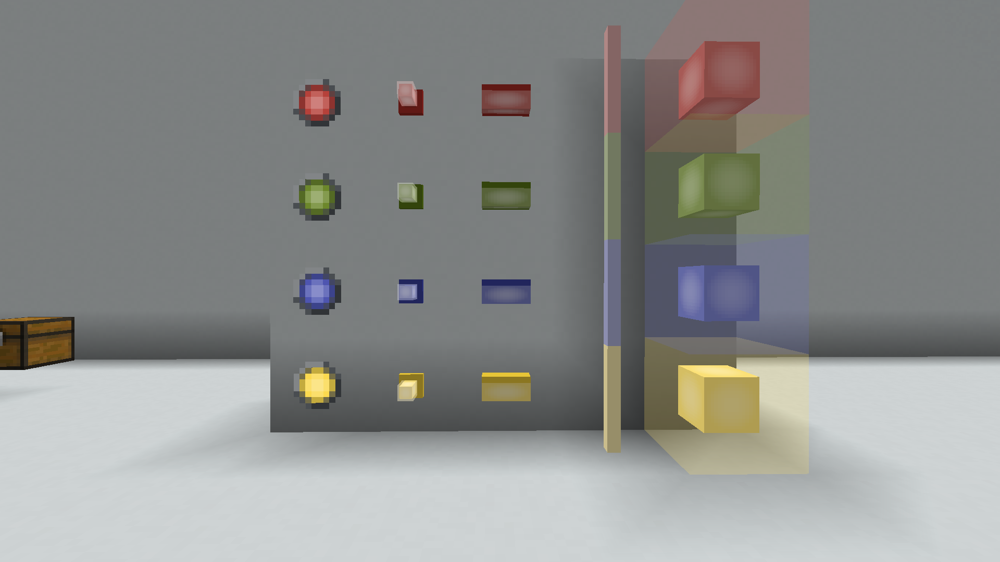

# Laterna

[English](README.md) | 日本語

染料16色のランプを、いくつもの形で追加します。自分で光るガラスと、周りの光を消すブロックもあります。
光っているときの明るさは15です。

- 形はランプ（フルブロック）・ハーフブロック・パネル・スポットライト・電球・照明器具・棒・ケース入りランプです。
- ハーフブロックとパネルは、横向きと縦向きが別のブロックです。1個ずつ相互に変換できます。
- スポットライトは設置面に埋まり、厚みがありません。床・壁・天井に置けます。
- ランプにはレッドストーンで点くものと消えるものがあります。
- 枠は3種類です。ランプと同じ色・黒・白で、石・磨かれたブラックストーン・クォーツのどれで作るかで決まります。
- 色は染料の色なので、同じ名前の羊毛・コンクリート・テラコッタと並べても揃います。
- 染料1個で同じ種類のランプ8個を染められます。

## スクリーンショット



他の絵は [branding/gallery](branding/gallery) にあります。説明は
[captions.md](branding/gallery/captions.md) です。

## 対象

| Minecraft | ローダー | ほかに必要なもの | Java |
|---|---|---|---|
| 1.21.1 | NeoForge 21.1 | | 21 |
| 1.21.1 | Fabric Loader 0.16 以降 | Fabric API 0.116 以降 | 21 |
| 1.20.1 | Forge 47 以降 | | 17 |
| 1.20.1 | Fabric Loader 0.15 以降 | Fabric API 0.92 以降 | 17 |
| 1.19.2 | Forge 43 以降 | | 17 |
| 1.19.2 | Fabric Loader 0.14 以降 | Fabric API 0.77 以降 | 17 |
| 1.18.2 | Forge 40 以降 | | 17 |
| 1.18.2 | Fabric Loader 0.14 以降 | Fabric API 0.77 以降 | 17 |
| 1.16.5 | Forge 36 以降 | | 8 |
| 1.16.5 | Fabric Loader 0.11 以降 | Fabric API 0.42 以降 | 8 |

組み合わせごとに jar が分かれていて、名前は `laterna-<ローダー>-<Minecraft>-<バージョン>.jar` です。

スポットライトの光る面が最大の明るさで描かれるのは、NeoForge 1.21.1 と Forge 1.20.1 だけです。
ほかのローダーにはモデルからそれを指定する仕組みが無いので、ほかの面と同じく周りの明るさで描かれます。

## ビルド

```
run.bat                   # コンパイルして、選択中のノードの開発クライアントを起動
gradlew build             # すべてのノードの jar を作る
gradlew runGameTestServer # ゲームテストのあるすべてのノードでゲームテストを実行
gradlew runData           # ブロックステート・モデル・テクスチャ・レシピ・言語ファイルを作り直す
```

Minecraft のバージョンとローダーの組み合わせごとに、[Stonecutter](https://stonecutter.kikugie.dev/)
のノードが1つあります。ノードの一覧は `settings.gradle.kts` にあり、それぞれ `versions/` の下に
フォルダを持ちます。jar は `versions/<ノード>/build/libs/` にできます。選択中のノードは
`stonecutter.gradle.kts` に書いてあり、`run.bat` が起動するのも、ソースに表示されるのもこのノードです。

Minecraft 1.16.5 にはゲームテストの仕組みが無いので、そのノードは開発クライアントでだけ確かめます。
この開発クライアントは `versions/1.16.5-forge/devfix/` も読み込みます。Architectury Loom が名前を
変換し損ねる `BlockMath` の2か所の呼び出しを直すコアモッドで、jar には入りません。

`runData` は 1.21.1 の NeoForge のノードでだけ動きます。他のノードは、ビルドのときにその出力を
自分の形式に変換します。

`JAVA_HOME` が JDK 21 を指しているか `java` が `PATH` にある必要があります。他のノードが使う
古い JDK は Gradle が取ってきます。

## 設計

[docs/design.md](docs/design.md)（英語）にあります。

## ライセンス

MIT。
