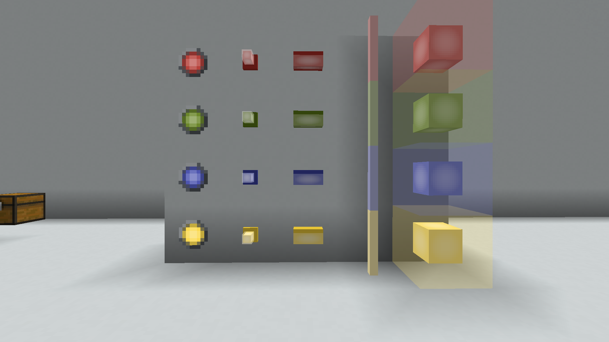

# Laterna

English | [日本語](README.ja.md)

Adds lamps in the sixteen dye colours, in several shapes, plus glass that is its own
light and one block that takes light away. Lit, they give off light level 15.

- Shapes: lamp, slab, panel, spotlight, bulb, fixture, rod and cased lamp.
- Slabs and panels are separate horizontal and vertical blocks, and one crafts into the
  other.
- The spotlight sits flush in the surface it is placed on, with no thickness at all.
- Lamps come two ways: one redstone switches on, one redstone switches off.
- Every framed shape comes three ways: the frame in the lamp's own colour, fixed black,
  or fixed white, decided by what the frame is made of — stone, polished blackstone or
  quartz.
- The colours are the game's own dye values, so a lamp sits correctly beside wool,
  concrete and terracotta of the same name.
- One dye colours eight lamps of a kind at a time.

## Screenshots



The rest are in [branding/gallery](branding/gallery), with their captions in
[captions.md](branding/gallery/captions.md).

## Target

| | |
|---|---|
| Minecraft | 1.21.1 |
| Loader | NeoForge 21.1.248 |
| Java | 21 |

## Build

```
run.bat                   # compile and launch a dev client for the active node
gradlew build             # produce a jar for every node
gradlew runGameTestServer # run every game test on every node that has them, headless, then exit
gradlew runData           # regenerate models, textures, recipes and language
```

Each Minecraft version and loader pair is a [Stonecutter](https://stonecutter.kikugie.dev/)
node, listed in `settings.gradle.kts` and given its own folder under `versions/`. A node's jar
is written to `versions/<node>/build/libs/`. The active node, named in `stonecutter.gradle.kts`,
is the one `run.bat` launches and the one the source tree shows.

Minecraft 1.16.5 has no game test framework, so its node is checked in a dev client only.

`runData` runs on the 1.21.1 NeoForge node only. The other nodes convert its output to their
own format when they build.

`JAVA_HOME` must point at a JDK 21, or `java` must be on `PATH`. Gradle fetches the older JDKs
the other nodes compile against.

## Design

See [docs/design.md](docs/design.md).

## License

MIT.
